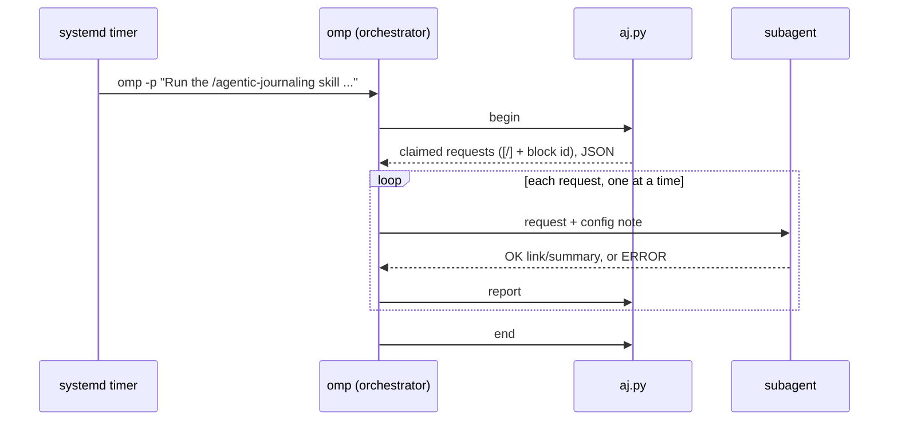

# Agentic Journaling

An agent skill that turns `#agent` tasks in your Obsidian daily notes into actions. Write a request under the notes it is about; a scheduled agent run carries it out against a named target (a knowledge base folder, an issue tracker, …) and writes the status and a result link back to the request.

```markdown
- Obsidian Journal View shows daily notes as one rolling page
    - Settings: folder Journal, newest first
- It reads the Daily Notes folder setting
- [ ] #agent add this to the KB
```

becomes, after the next run:

```markdown
- [x] #agent add this to the KB ^agent-7f3a
    - Updated [Obsidian Journal View](KB/tools/obsidian-journal-view.md): added the folder setting. Run r7k2.
```

No running Obsidian app is needed. Everything works on the vault files directly. The design is in [Agentic Journaling Skill Specification.md](Agentic%20Journaling%20Skill%20Specification.md).

## How it works

- **Scripts** (`.agents/skills/agentic-journaling/scripts/aj.py`, Python with inline dependencies, run by `uv`) do the mechanics: configuration, discovery, request scope, block ids, status, feedback, compare-and-swap file writes and logging.
- **The agent** does only what needs judgment: it matches each request to a target and follows that target's plain-language instructions in your config note. Each request runs in its own subagent, one at a time.
- **State lives in the journal.** The checkbox is the status, a block id `^agent-xxxx` is the identity. There is no database.



## Repository layout

```text
.agents/skills/agentic-journaling/
  SKILL.md               run procedure the agent follows
  scripts/aj.py          init, check, begin, report, end
  templates/docs.md      docs block rendered into each config note
deploy/
  agentic-journal.service
  agentic-journal.timer
README.md
```

The skill sits in the repo-local skill directory `.agents/skills/`. A harness started with this checkout as working directory loads it; nothing is installed into your home directory. The run prompt also names the `SKILL.md` path explicitly.

## Requirements

- Linux with systemd (user manager) and journald
- [`uv`](https://docs.astral.sh/uv/) (fetches Python ≥ 3.11 and PyYAML on first use)
- [`rg`](https://github.com/BurntSushi/ripgrep) on `PATH`
- `omp` (oh-my-pi), logged in to a model provider; the skill needs a harness with a subagent/task tool
- An Obsidian vault with the Daily Notes core plugin configured (`.obsidian/daily-notes.json`)

## Install

### 1. Check out the repository

```sh
git clone <repo-url> ~/work/agentic-journaling
cd ~/work/agentic-journaling
```

The checkout is the installation. Update with `git pull`.

### 2. Register a journal

`init` creates the machine file `~/.config/agentic-journal/config.yaml` (or adds to it) and a config note `Agentic Journaling.md` in the given journal folder. Pass the vault's Daily Notes folder: only that folder is scanned for requests.

```sh
AJ=.agents/skills/agentic-journaling/scripts/aj.py
uv run $AJ init --name main ~/Notes/Main/Journal
```

Resulting machine file:

```yaml
version: 1
journals:
  main: ~/Notes/Main/Journal/Agentic Journaling.md
```

More journals are more entries (`uv run $AJ init --name work ~/Notes/Work/Journal`). A run processes all of them; `--journal <name>` limits a command to one.

### 3. Describe your targets

Open `Agentic Journaling.md` in Obsidian and add one `### <name>` section per target under `## Targets` (examples [below](#example-config-note)). Leave the block between the `%% agentic-journal:docs … %%` markers alone; runs rewrite it.

### 4. Check

```sh
uv run $AJ check
```

`check` is read-only. It validates both files, lists targets and warns about empty sections or aliases shared by two targets, says whether the docs block would be re-rendered, previews every open request with the content it covers, and lists requests stuck at `[/]`.

### 5. Run once by hand

```sh
cd ~/work/agentic-journaling
omp -p "Run the /agentic-journaling skill: read .agents/skills/agentic-journaling/SKILL.md and follow it to run a propagation for every configured journal."
```

omp prints only its final summary. Watch the log lines live in a second terminal:

```sh
journalctl --user -t agentic-journal -f
```

### 6. Schedule with systemd

Link the units from the checkout and add a drop-in with your machine's settings:

```sh
systemctl --user link ~/work/agentic-journaling/deploy/agentic-journal.service \
                      ~/work/agentic-journaling/deploy/agentic-journal.timer
systemctl --user edit agentic-journal.service
```

In the editor, add (adjust paths to where `omp`, `uv` and `rg` live; `command -v omp uv rg` shows them):

```ini
[Service]
WorkingDirectory=%h/work/agentic-journaling
Environment=PATH=/home/linuxbrew/.linuxbrew/bin:%h/.local/bin:/usr/local/bin:/usr/bin:/bin
# Optional: provider API keys or other variables a target needs, one VAR=value per line.
EnvironmentFile=-%h/.config/agentic-journal/env
```

The service does not read your shell profile, so `PATH` and any variables omp or a target section relies on (for example `GH_TOKEN`) must come from here or from the env file. Keep that file `chmod 600`.

Optional, a different schedule (default: hourly):

```sh
systemctl --user edit agentic-journal.timer
```

```ini
[Timer]
OnCalendar=
OnCalendar=*-*-* 07..22:00/30
```

Enable the timer, and let runs happen while you are logged out:

```sh
systemctl --user enable --now agentic-journal.timer
loginctl enable-linger "$USER"
systemctl --user list-timers agentic-journal.timer
```

`Persistent=true` starts a run missed during sleep on wake. `TimeoutStartSec=30min` stops a hung run; requests it had claimed stay at `[/]` (see [Troubleshooting](#troubleshooting)).

Start a scheduled-style run now, with exactly the service's environment:

```sh
systemctl --user start --no-block agentic-journal.service
journalctl --user -t agentic-journal -f
```

## Using it in your journal

### Writing a request

A request is a task item tagged `#agent`, written as the **last** item of the content it covers, at the same list level. The instruction names a target or one of its aliases and may say what to do.

```markdown
## Meeting with Dana

- Sync service retries failed uploads 3 times
    - backoff starts at 2 s, doubles
- Retries are not logged yet
- [ ] #agent add to the KB under the sync service concept
```

The request covers the items above it at the same level, with their children. Collection stops at the first of: the start of the parent item, a heading or a plain paragraph, an earlier `#agent` request at the same level. The parent item and the nearest heading are passed along as context.

Nested requests work the same way, inside a parent item:

```markdown
- Project Atlas
    - export breaks on files with spaces
    - repro: export "My File.md"
    - [ ] #agent open an issue in atlas
    - decided to drop the legacy importer
    - [ ] #agent add to the KB
```

Here the first request covers the two items about the export bug; the second covers only "decided to drop the legacy importer", because collection stops at the earlier request. "Project Atlas" is context for both.

Ignored: `#agent` in fenced code, in inline code, inside `%% … %%` comments, and anywhere in the config note.

A request with no items above it at its level is an error:

```markdown
Some paragraph.
- [ ] #agent add this to the KB
    - Failed: the request has no items above it at the same list level. Run r7k2.
```

### Status

| Checkbox | Status | Picked up by a run |
| --- | --- | --- |
| `[ ]` | open | yes |
| `[/]` | in progress | no |
| `[x]` | done | no |
| `[!]` | error | no |
| `[-]` | cancelled | no |

- **Retry:** set `[!]` (or `[x]`) back to `[ ]`. The next run keeps the block id and replaces its earlier feedback line; your own sub-items stay.
- **Cancel:** set `[-]` before the next run.
- Files changed in the last 30 s are skipped, so a run never picks up a request you are still typing. They are processed by the next run.

### Feedback

The run writes one sub-item under the request, in plain sentences, ending with the run id:

```markdown
- [x] #agent add this to the KB ^agent-7f3a
    - Created [Sync service retries](KB/sync/sync-service-retries.md): added retry count and backoff. Run r7k2.
- [x] #agent open an issue in atlas ^agent-k2p9
    - Done [atlas#41](https://github.com/me/atlas/issues/41): opened an issue for the export bug. Run r7k2.
- [!] #agent add this to the wiki ^agent-q81m
    - Failed: "wiki" matches both kb and docs. Run r7k2.
```

## Example config note

`Agentic Journaling.md`, at the top of the journal folder. The frontmatter holds only `agentic-journal: 1`; the note never holds secrets or run state.

````markdown
---
agentic-journal: 1
---
# Agentic Journaling

%% agentic-journal:docs start (maintained by the agent, edits here are replaced) %%
… rendered by the scripts: how requests work, status table, list of targets …
%% agentic-journal:docs end %%

## Targets

### kb

Aliases: KB, knowledge base, wiki

The knowledge base is the folder `KB/` in this vault. It is an OKF bundle and follows the Open Knowledge Format v0.2 spec. Every `.md` file in it is a concept, except `index.md` and `log.md`.

- Update an existing concept when it covers the same subject. Otherwise create one.
- New concept: file name from the title, frontmatter `type`, `title`, `description`, `tags`.
- Add a `sources` entry with `id` = the request's block id, linking back to the journal block.
- Use relative Markdown links.
- Update the folder's `index.md` and `log.md`.

Return the concept's vault path, created or updated, and one sentence on what was added.

### atlas

Aliases: atlas issues, atlas tracker

Issues for Project Atlas live in the GitHub repository `me/atlas`. Use the `gh` CLI; it is logged in already (`gh auth status`). Never use another credential.

- Search open issues first (`gh issue list --repo me/atlas --search ...`). If one covers the same problem, add a comment with the new details instead of opening a new issue.
- New issue: a short imperative title, the covered content as the body, label `from-journal`.
- End the body or comment with "Source: journal request ^<block id>".

Return the issue URL, created or updated, and one sentence on what was filed.

### reading

Aliases: reading list, to read

The reading list is the note `Lists/Reading.md` in this vault, a table with columns Title, Link, Added, Why.

- Add one row per link found in the covered content; skip links already in the table.
- Added is today's date (YYYY-MM-DD). Why is one short phrase from the covered content.

Return `Lists/Reading.md`, updated, and one sentence naming the added titles.
````

Write target sections like an instructions file for a careful colleague: where the target lives, which spec, tools or helper scripts to use, which env var or CLI login holds the credentials, when to create and when to update, and what to return. A new target is just a new section; the skill has no target code.

## Logs

Each event is one line: an ISO 8601 timestamp, then logfmt pairs. Every line has `run=` and `ev=`; lines about a request have `id=`.

```text
2026-11-21T14:03:12+01:00 run=r7k2 ev=discover id=agent-7f3a file="Journal/2026-11-21.md" text="add this to the KB"
```

| `ev` | When |
| --- | --- |
| `run-start` | a run starts for a journal (`journal=`) |
| `discover` | a request got its id and `[/]` |
| `action` | the target step finished (`target`, `link` and `summary`, or `error`) |
| `state` | the final status was written (`status=done`/`error`) |
| `error` | a step failed, or a request is stuck at `[/]` |
| `skipped` | a request could not be claimed; it stays `[ ]` for the next run |
| `run-end` | the run ends |

The lines go to stdout and, from every run (timer or manual), to journald under the identifier `agentic-journal`:

```sh
journalctl --user -t agentic-journal -g agent-7f3a      # one request's history
journalctl --user -t agentic-journal -g 'run=r7k2'      # one run
journalctl --user -t agentic-journal -g 'ev=state' --since today
journalctl --user -u agentic-journal                    # timer runs incl. omp's own output
```

Retention is journald's. The agent's full transcript of a run is kept as an omp session (`omp -r`).

## Troubleshooting

- **A request stays `[/]`.** A run was interrupted (timeout, crash, sleep) after claiming it. Runs never reclaim these; each run logs an `error` line for them and `check` lists them. Set the checkbox back to `[ ]`.
- **`skipped` in the log.** The note changed while the run was claiming the request, more than 3 retries in a row. The request stays `[ ]` for the next run.
- **Nothing happens.** Run `uv run $AJ check`: is the request in the Daily Notes folder, a task item (`- [ ]`), outside code and comments, and its file not changed in the last 30 s?
- **Service fails with "omp: No such file or directory".** `PATH` in the drop-in is missing omp's folder.

## Deviations from the specification

- **Log output:** the scripts run inside the agent's tool calls, so their stdout reaches the agent, not the service. Each line is therefore also sent straight to journald (`SYSLOG_IDENTIFIER=agentic-journal`), from timer and manual runs alike. Query with `-t agentic-journal`; `-u agentic-journal` additionally shows omp's own output but only for timer runs. A manual run does not print log lines in its terminal; follow them with `journalctl --user -t agentic-journal -f`.
- **`run-end`** carries only `run=`: no duration and no `found`/`completed`/`failed`/`skipped` counts. Count from the log (`-g 'run=r7k2'`). Every run writes `run-start` … `run-end`, also when it finds nothing.
- **Service:** `ExecStart=/usr/bin/env omp -p "<run prompt>"`, so `omp` is resolved through the drop-in's `PATH`. The checkout path, `PATH` and environment live in a drop-in, not in the repo unit. `TimeoutStartSec=30min`.
- **Stuck `[/]` requests** are reported (`check`, an `error` line per run) but never reclaimed.
- **Subagents:** each request runs in its own subagent, sequentially; the harness must provide a subagent/task tool.
