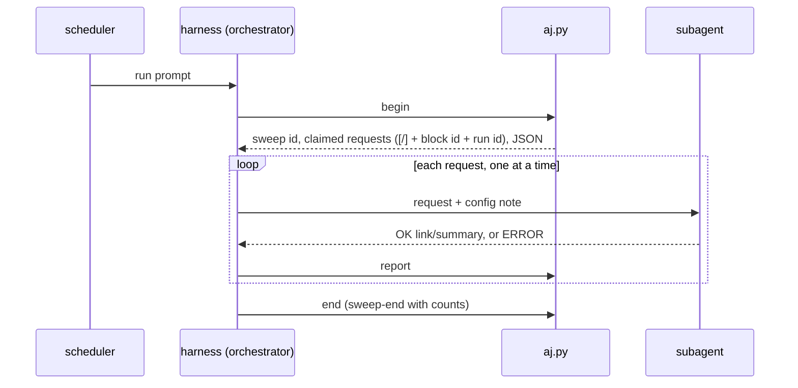

# Agentic Journaling

An agent skill that turns `#agent` tasks in your Obsidian daily notes into actions. Write a request under the notes it is about. A scheduled agent run carries it out against a named target (a knowledge base folder, an issue tracker, …) and writes the status and a result link back to the request.

```markdown
- Obsidian Journal View shows daily notes as one rolling page
    - Settings: folder Journal, newest first
- It reads the Daily Notes folder setting
- [ ] #agent add the two Journal View items above to the KB
```

becomes, after the next run:

```markdown
- [x] #agent add the two Journal View items above to the KB ^aj-block-7f3a
```

and the journal's `Agentic Journaling Log.md` gets a row:

```markdown
| 2026-11-21 14:02 | [[Journal/2026-11-21#^aj-block-7f3a\|aj-block-7f3a]] | `aj-run-x9k2` | Updated [[KB/tools/obsidian-journal-view\|Obsidian Journal View]]: added the folder setting from the two Journal View items. |
```

No running Obsidian app is needed; everything works on the vault files directly. It runs on Linux, macOS and Windows, under omp, GitHub Copilot or Claude.

## How it works

- **Scripts** (`.agents/skills/agentic-journaling/scripts/aj.py`, Python with inline dependencies, run by `uv`) do the mechanics: configuration, discovery, block ids, status, the result log, compare-and-swap file writes and logging.
- **The agent** does only what needs judgment: it matches each request to a target and follows that target's plain-language instructions in your config note. Each request runs in its own subagent, one at a time, so the harness must provide a subagent tool (omp and Copilot: `task`, Claude: `Agent`).
- **State lives in the journal.** The checkbox is the status; a block id `^aj-block-xxxx` is the identity. There is no database.
- **Ids.** One invocation runs one **sweep** per journal (`aj-sweep-3k9q`). Each request processed in it gets its own **run** id (`aj-run-x9k2`); a retry of the same request keeps its block id (`aj-block-7f3a`) and gets a new run id. Log lines about a request carry both.



## Repository layout

```text
.agents/skills/agentic-journaling/
  SKILL.md               run procedure the agent follows
  scripts/aj.py          init, check, begin, report, end
  templates/docs.md      docs block rendered into each config note
deploy/systemd/
  agentic-journal.service
  agentic-journal.timer
README.md
```

The skill sits in `.agents/skills/`, which omp and Copilot load from the working directory. The run prompt also names the `SKILL.md` path explicitly, so a harness that does not scan `.agents/skills/` (Claude reads only `.claude/skills/`) follows it as well. Nothing is installed into your home directory.

## Requirements

- [`uv`](https://docs.astral.sh/uv/) (fetches Python ≥ 3.11 and PyYAML on first use)
- [`rg`](https://github.com/BurntSushi/ripgrep) on `PATH`
- One harness with a subagent tool, logged in to a model provider: `omp` (oh-my-pi), GitHub Copilot (app or CLI), or Claude (desktop app or Claude Code CLI)
- An Obsidian vault with the Daily Notes core plugin configured (`.obsidian/daily-notes.json`)

## Install

### 1. Check out the repository

```sh
git clone <repo-url> ~/work/agentic-journaling
cd ~/work/agentic-journaling
```

The checkout is the installation. Update with `git pull`.

### 2. Register a journal

`init` creates the machine file (or adds to it) and a config note `Agentic Journaling.md` in the given journal folder. Pass the vault's Daily Notes folder: only that folder is scanned for requests.

```sh
uv run .agents/skills/agentic-journaling/scripts/aj.py init --name main ~/Notes/Main/Journal
```

The machine file lives at:

| OS | Machine file |
| --- | --- |
| Linux | `$XDG_CONFIG_HOME/agentic-journal/config.yaml` (default `~/.config/…`) |
| macOS | `~/Library/Application Support/agentic-journal/config.yaml` |
| Windows | `%APPDATA%\agentic-journal\config.yaml` |

```yaml
version: 1
log:                       # optional, see Logs
  file: ~/logs/agentic-journal.log
  retention_days: 30
journals:
  main: ~/Notes/Main/Journal/Agentic Journaling.md
```

More journals are more entries (`init --name work ~/Notes/Work/Journal`). A run processes all of them; `--journal <name>` limits a command to one.

### 3. Describe your targets

Open `Agentic Journaling.md` in Obsidian and add one `### <name>` section per target under `## Targets` (examples [below](#example-config-note)). Leave the block between the `%% agentic-journal:docs … %%` markers alone; runs rewrite it.

### 4. Check

```sh
uv run .agents/skills/agentic-journaling/scripts/aj.py check
```

`check` is read-only. It validates both files, shows the log file, lists targets and warns about empty sections or aliases shared by two targets, says whether the docs block would be re-rendered, lists every open request with its file and line, and lists requests stuck at `[/]`.

## Running it

Every harness gets the same run prompt, started with the checkout as its working directory:

```text
Run the /agentic-journaling skill: read .agents/skills/agentic-journaling/SKILL.md and follow it to run a propagation for every configured journal.
```

A run needs, without approval prompts: shell commands (`uv`, `rg`, plus whatever CLIs your target sections use, e.g. `gh`), file reads and edits in the vault, and the subagent tool. The vault usually lies outside the checkout, so grant access to it explicitly. A scheduled run that hits an approval prompt stalls.

### omp, scheduled by systemd (Linux)

Run once by hand:

```sh
cd ~/work/agentic-journaling
omp -p "Run the /agentic-journaling skill: read .agents/skills/agentic-journaling/SKILL.md and follow it to run a propagation for every configured journal."
```

Schedule it: link the units from the checkout and add a drop-in with your machine's settings.

```sh
systemctl --user link ~/work/agentic-journaling/deploy/systemd/agentic-journal.service ~/work/agentic-journaling/deploy/systemd/agentic-journal.timer
systemctl --user edit agentic-journal.service
```

In the editor, add (adjust paths to where `omp`, `uv` and `rg` live; `command -v omp uv rg` shows them):

```ini
[Service]
WorkingDirectory=%h/work/agentic-journaling
Environment=PATH=/home/linuxbrew/.linuxbrew/bin:%h/.local/bin:/usr/local/bin:/usr/bin:/bin
# Optional: provider API keys or other variables a target needs, one VAR=value per line.
EnvironmentFile=-%h/.config/agentic-journal/env
```

The service does not read your shell profile, so `PATH` and any variables omp or a target section relies on (for example `GH_TOKEN`) must come from here or from the env file. Keep that file `chmod 600`. `ExecStart` is `/usr/bin/env omp -p "<run prompt>"`, so `omp` is found through this `PATH`.

Optional, a different schedule (default: hourly):

```sh
systemctl --user edit agentic-journal.timer
```

```ini
[Timer]
OnCalendar=
OnCalendar=*-*-* 07..22:00/30
```

Enable the timer, and let runs happen while you are logged out:

```sh
systemctl --user enable --now agentic-journal.timer
loginctl enable-linger "$USER"
systemctl --user list-timers agentic-journal.timer
```

`Persistent=true` starts a run missed during sleep on wake. `TimeoutStartSec=30min` stops a hung run; requests it had claimed stay at `[/]` (see [Troubleshooting](#troubleshooting)). `journalctl --user -u agentic-journal` shows omp's own output; the run log is in the log file. The full transcript is an omp session (`omp -r`).

### GitHub Copilot, scheduled by a Copilot app automation (any OS)

Run once by hand with the Copilot CLI (one line; works in bash and PowerShell):

```sh
copilot -C ~/work/agentic-journaling --add-dir ~/Notes/Main --allow-all-tools --no-ask-user -p "Run the /agentic-journaling skill: read .agents/skills/agentic-journaling/SKILL.md and follow it to run a propagation for every configured journal."
```

`--add-dir` grants the vault; `--allow-all-tools` lets shell commands, edits and subagents run unprompted. Narrow it with `--allow-tool` if your targets use a known set of commands. Transcripts are kept under `~/.copilot/session-state/`.

Schedule it in the GitHub Copilot app: **Automations → Create automation**. Prompt: the run prompt. Location: the **local folder** of the checkout (not a cloud automation: cloud runs cannot reach your vault). Trigger: a schedule. Start it once with the play button and check that it runs through without approval prompts.

### Claude, scheduled by a Claude desktop scheduled task (any OS)

Run once by hand with Claude Code, from the checkout:

```sh
claude -p "Run the /agentic-journaling skill: read .agents/skills/agentic-journaling/SKILL.md and follow it to run a propagation for every configured journal." --add-dir ~/Notes/Main --allowedTools "Bash,Read,Edit,Write,Agent"
```

On native Windows, Claude Code uses Git Bash when Git for Windows is installed, else PowerShell; both run the skill's one-line commands.

Schedule it in the Claude desktop app, Code tab: **Scheduled → New task**. Instructions: the run prompt. Advanced settings: **Only on this computer**, local folder = the checkout. Pick a permission mode that does not ask for shell commands and edits, or click **Run now** once and answer each prompt with "always allow", including access to the vault folder.

### Limits of app schedulers

Copilot automations and Claude scheduled tasks run only while the app is open and the computer is awake. A slot missed during sleep is skipped or runs late. systemd has neither limit (`Persistent=true`, linger).

## Using it in your journal

### Writing a request

A request is a task item tagged `#agent`, anywhere in a daily note. The instruction says what to do and which content it is about, and preferably names a target or one of its aliases. Without a target the agent follows the instruction alone; an instruction matching two targets fails. The agent reads the note and works out the content from the instruction alone; there are no positional rules or keywords. The content can be items in the same note, other notes, or nothing:

```markdown
## Meeting with Dana

- Sync service retries failed uploads 3 times
    - backoff starts at 2 s, doubles
- Retries are not logged yet
- [ ] #agent add the two retry items above to the KB under the sync service concept
- [ ] #agent create a KB concept on retry backoff strategies
- [ ] #agent add a KB page summarizing all notes in Projects whose names start with A
```

An instruction that leaves the content or the task unclear fails with an error naming what is unclear. The result summary names the content the agent used, so a wrong pick shows up in the log note.

Ignored: `#agent` in fenced code, in inline code, inside `%% … %%` comments, and anywhere in the config note.

### Status

| Checkbox | Status | Picked up by a run |
| --- | --- | --- |
| `[ ]` | open | yes |
| `[/]` | in progress | no |
| `[x]` | done | no |
| `[!]` | error | no |
| `[-]` | cancelled | no |

- **Retry:** set `[!]` (or `[x]`) back to `[ ]`. The next run keeps the block id, gets a new run id and adds a new row to the log note; earlier rows stay.
- **Cancel:** set `[-]` before the next run.
- **Interrupted runs:** a request left at `[/]` is never reclaimed. Each sweep logs an `error` line for it and `check` lists it. Set it back to `[ ]` to retry.
- Files changed in the last 30 s are skipped, so a run never picks up a request you are still typing. They are processed by the next run.
- Files keep their line endings: a CRLF note stays CRLF.

### Result log

Each result goes into `Agentic Journaling Log.md`, next to the config note, created on the first result. The run inserts one row at the top of its table, so the newest result comes first. The Request column links to the request's block:

```markdown
| Time | Request | Run | Result |
| --- | --- | --- | --- |
| 2026-11-21 14:03 | [[Journal/2026-11-21#^aj-block-q81m\|aj-block-q81m]] | `aj-run-b05n` | Failed: "wiki" matches both `kb` and `docs`. |
| 2026-11-21 14:02 | [[Journal/2026-11-21#^aj-block-k2p9\|aj-block-k2p9]] | `aj-run-7hvd` | Done [atlas#41](https://github.com/me/atlas/issues/41): opened an issue for the export bug. |
| 2026-11-21 14:01 | [[Journal/2026-11-21#^aj-block-7f3a\|aj-block-7f3a]] | `aj-run-x9k2` | Created [[KB/sync/sync-service-retries\|Sync service retries]]: added retry count and backoff from the two retry items. |
```

Rows are never rewritten; a retry adds a new row. Vault notes in a result show as wiki links, URLs as Markdown links. Obsidian's backlinks panel of a daily note lists the rows for its requests. You can edit or prune the table; keep its header row.

## Example config note

`Agentic Journaling.md`, at the top of the journal folder. The frontmatter holds only `agentic-journal: 1`; the note never holds secrets or run state.

````markdown
---
agentic-journal: 1
---
# Agentic Journaling

%% agentic-journal:docs start (maintained by the agent, edits here are replaced) %%
… rendered by the scripts: how to raise a request …
%% agentic-journal:docs end %%

## Targets

### kb

Aliases: KB, knowledge base, wiki

The knowledge base is the folder `KB/` in this vault. It is an OKF bundle and follows the Open Knowledge Format v0.3 spec. Every `.md` file in it with a `type` in its frontmatter is a concept; `index.md` and `log.md` are reserved.

- Update an existing concept when it covers the same subject. Otherwise create one.
- New concept: file name = the title, frontmatter `type`, `title`, `description`, `tags`, then the H1 (same as the file name) right after the frontmatter.
- Add a `sources` entry for the daily note the request is in (relative path, no block reference).
- Use relative Markdown links.
- Update the folder's `index.md` and `log.md`.

Return the concept's vault path, created or updated, and one sentence on what was added.

### atlas

Aliases: atlas issues, atlas tracker

Issues for Project Atlas live in the GitHub repository `me/atlas`. Use the `gh` CLI; it is logged in already (`gh auth status`). Never use another credential.

- Search open issues first (`gh issue list --repo me/atlas --search ...`). If one covers the same problem, add a comment with the new details instead of opening a new issue.
- New issue: a short imperative title, the request's content as the body, label `from-journal`.
- End the body or comment with "Source: journal of <note date>".

Return the issue URL, created or updated, and one sentence on what was filed.

### reading

Aliases: reading list, to read

The reading list is the note `Lists/Reading.md` in this vault, a table with columns Title, Link, Added, Why.

- Add one row per link found in the request's content; skip links already in the table.
- Added is today's date (YYYY-MM-DD). Why is one short phrase from the request's content.

Return `Lists/Reading.md`, updated, and one sentence naming the added titles.
````

Write target sections like an instructions file for a careful colleague: where the target lives, which spec, tools or helper scripts to use, which env var or CLI login holds the credentials, when to create and when to update, and what to return. A new target is just a new section; the skill has no target code.

## Logs

Every `aj.py` call writes its events to the log file and prints the same lines on stdout (where the agent sees them). Each event is one line: an ISO 8601 timestamp, then logfmt pairs.

```text
2026-11-21T14:03:12+01:00 sweep=aj-sweep-3k9q ev=discover run=aj-run-x9k2 block=aj-block-7f3a file="Journal/2026-11-21.md" text="add this to the KB"
```

Every line has `sweep=` and `ev=`. Lines about a request also have `run=` and `block=`; `sweep-start` and `sweep-end` have `journal=`.

| `ev` | When |
| --- | --- |
| `sweep-start` | a sweep starts for a journal |
| `discover` | a request got its block id, run id and `[/]` |
| `action` | the target step finished (`target`, `link` and `summary`, or `error`) |
| `state` | the final status was written (`status=done`/`error`) |
| `error` | a step failed, or a request is stuck at `[/]` |
| `skipped` | a request could not be claimed; it stays `[ ]` for the next run |
| `sweep-end` | the sweep ends: `duration`, `found`, `completed`, `failed`, `skipped` |

`found` counts the requests the sweep picked up (`discover` plus `skipped`). When a `report` failed to write its result, `completed + failed + skipped` is less than `found`.

**Where.** `log.file` in the machine file, or by default:

| OS | Log file |
| --- | --- |
| Linux | `$XDG_STATE_HOME/agentic-journal/agentic-journal.log` (default `~/.local/state/…`) |
| macOS | `~/Library/Logs/agentic-journal/agentic-journal.log` |
| Windows | `%LOCALAPPDATA%\agentic-journal\agentic-journal.log` |

**Rotation and retention.** At its start, each `aj.py` call renames a log last written on an earlier day to `agentic-journal.log.YYYY-MM-DD`, and deletes rotated files older than `log.retention_days` (default 30). If the file is in use and cannot be renamed, the next call retries.

**Queries.**

```sh
grep aj-block-7f3a ~/.local/state/agentic-journal/agentic-journal.log*        # every run of one request
grep aj-run-x9k2 ~/.local/state/agentic-journal/agentic-journal.log*          # one run
grep 'sweep=aj-sweep-3k9q ' ~/.local/state/agentic-journal/agentic-journal.log*   # one sweep
```

```powershell
Select-String aj-block-7f3a "$env:LOCALAPPDATA\agentic-journal\agentic-journal.log*"
```

## Troubleshooting

- **A request stays `[/]`.** A run was interrupted (timeout, crash, sleep, app closed) after claiming it. See Status → Interrupted runs.
- **`skipped` in the log.** The note changed while the run was claiming the request (or, on Windows, stayed locked by another program) through 3 retries in a row. The request stays `[ ]` for the next run.
- **Nothing happens.** Run `check`: is the request in the Daily Notes folder, a task item (`- [ ]`), outside code and comments, and its file not changed in the last 30 s? Is the scheduled run stalled at an approval prompt?
- **systemd service fails with "omp: No such file or directory".** `PATH` in the drop-in is missing omp's folder.
